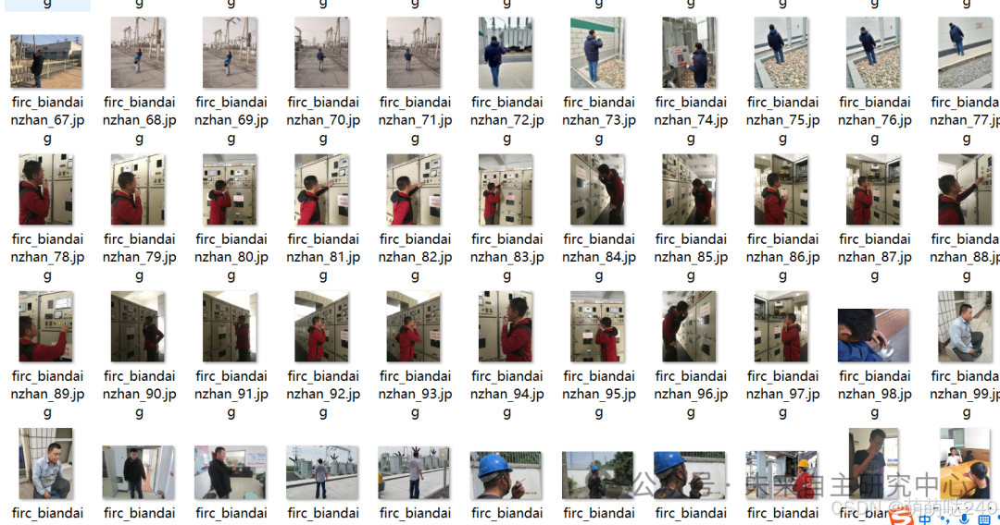
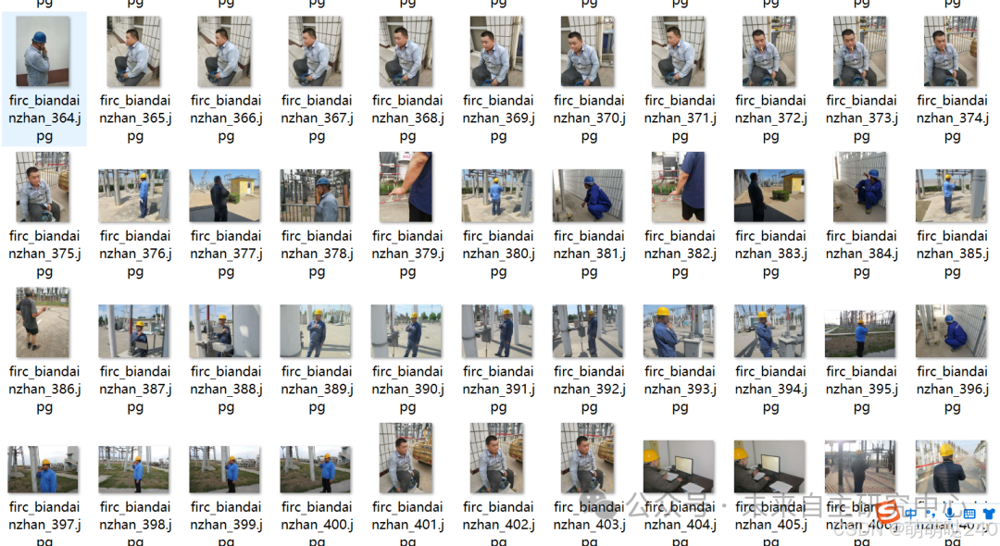
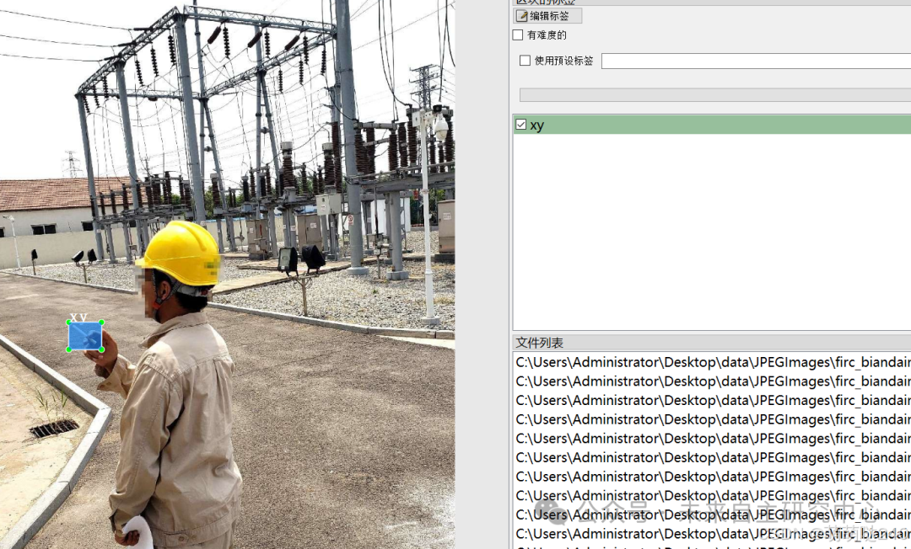

# Power Scene Substation Smoking Detection Dataset VOC+YOLO format with 578 images in 1 category

Dataset format: Pascal VOC format + YOLO format (txt file without split path, only containing jpg images and corresponding VOC format xml files and yolo format txt files)
Number of images (number of jpg files): 578
Number of annotations (number of xml files): 578
Number of annotations (number of txt files): 578
Number of annotation categories: 1
Annotation category names: ["xy"]
Number of boxes per category:
xy box count = 607
Total box count: 607
Labeling tool used: labelImg

Annotation rules: Draw a rectangle around the category.
Important Notice: No
Special : This dataset does not guarantee the accuracy or precision of the trained models or weight files. The dataset is provided with accurate and reasonable annotations only.

Image Preview:

Annotation example:

## Payment

Here is a pay link on Stripe ( https://buy.stripe.com/3cs8yP7sY87d0vu9AB ). Please contact me lonlonago@foxmail.com after funding $89, and I will send you a complete data files , thank you!

